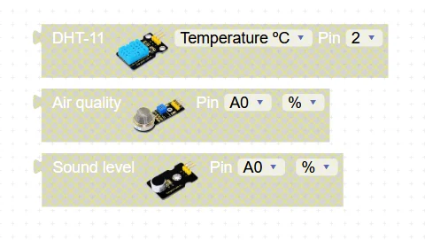
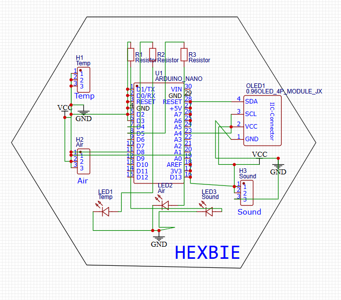
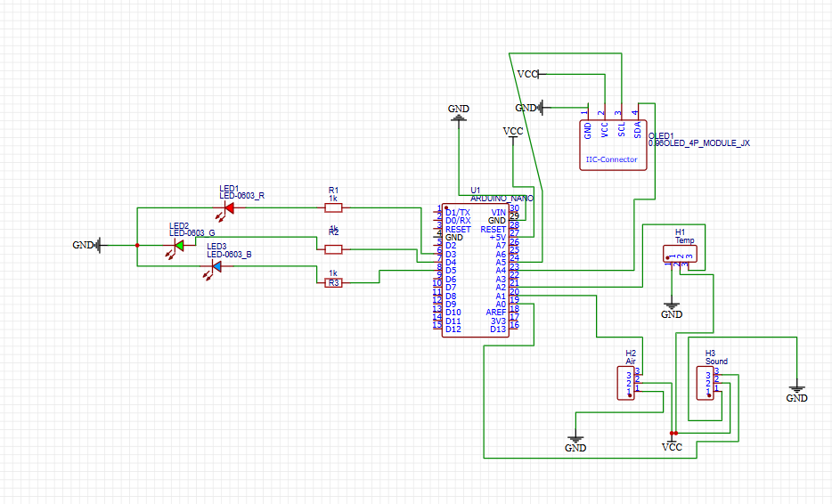
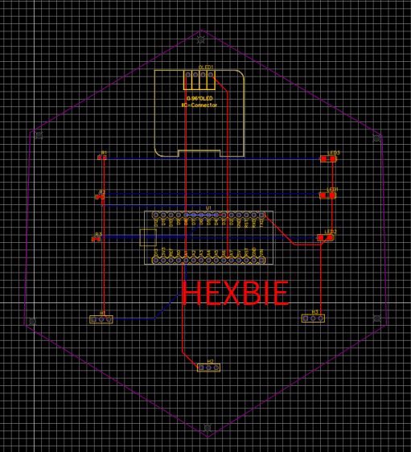
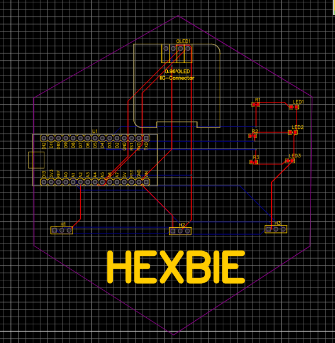
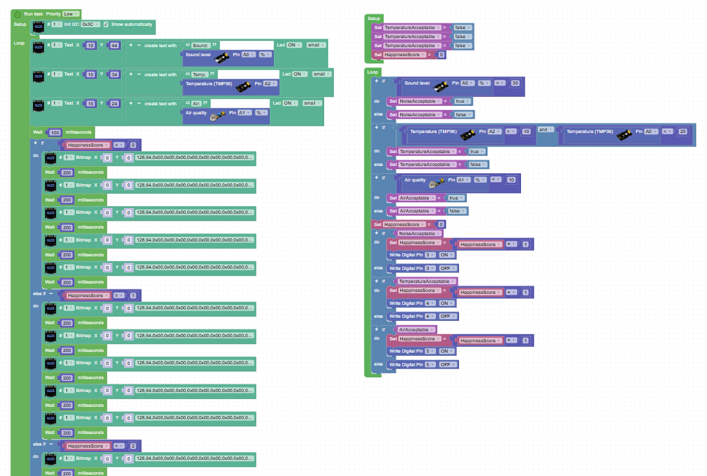
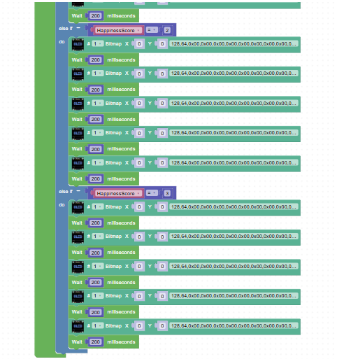

# Hexbie-Starbie-but-HEXAGON
This is my first project for Hack Club's Half Life!
The week's theme is PCB and I am making a hexagonal Starbie called Hexbie that will be my desk companion that monitors the air and environment, keeping it good for my health.
When I originally planned to build the Hexbie, I drew up what I wanted it to look like in a notebook, and then found components and parts to suit my needs for the project.
And here are the code elements I was using for detection:

I used EasyEDA to create my schematic and board, and then used JLCPCB to manufacture it. I had some issues during my first time drawing up my schematic which are higlighted in my journal entries. Below are the two versions of my schematic:
The first version:

And here is the second, updated version:

Now, for routing the board, I definitely improved on the second go because I had already gotten a feel for the software and how things work. The schematic was also not totally broken... Here is the first one:

And here is the second, improved one:

You can find my bill of materials in the file "BOM.csv".

For my code, I went through a few iterations to make it work better. An in depth version of the changes are in my journal entries. Here is an overview of the code that I am using:
There are two parts of the code that have their own enclosing blocks.
- there are the sensing blocks and system that determines how good the environment is. This system senses the environment and determines if each variable is considered to be good. Then, depending on how many factors are doing well, it will update the happiness score.
- The other system includes alternating screens that show the actual numbers that the sensors are measuring so that improvements can be made and the other screen has faces (With animations of course) that show the happiness score through their expressions.
I had to take two screenshots of the code because it is too big.

I had fun making this project.
Sorry about resubmitting before doing the stuff, I didn't know where to find edit requests... all I saw was one small thing on the project and thought it was enough. Thanks for the help!
